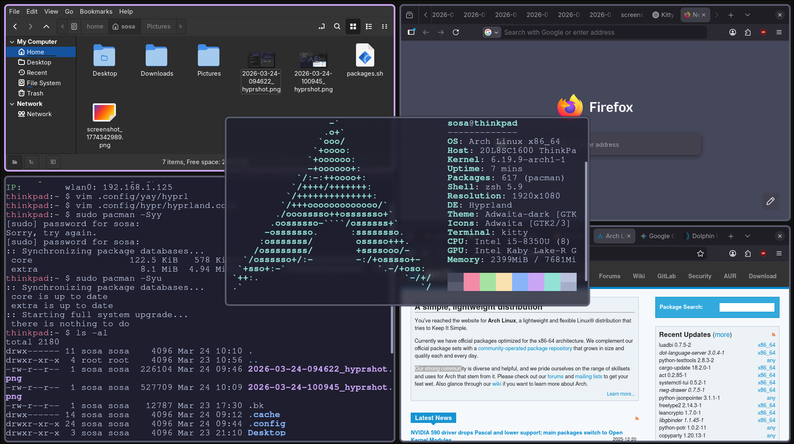
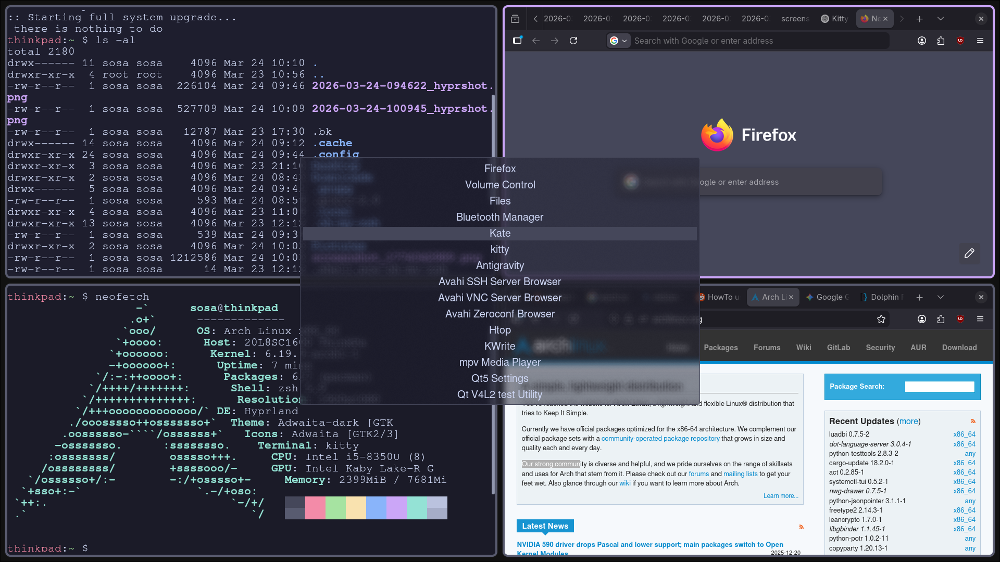
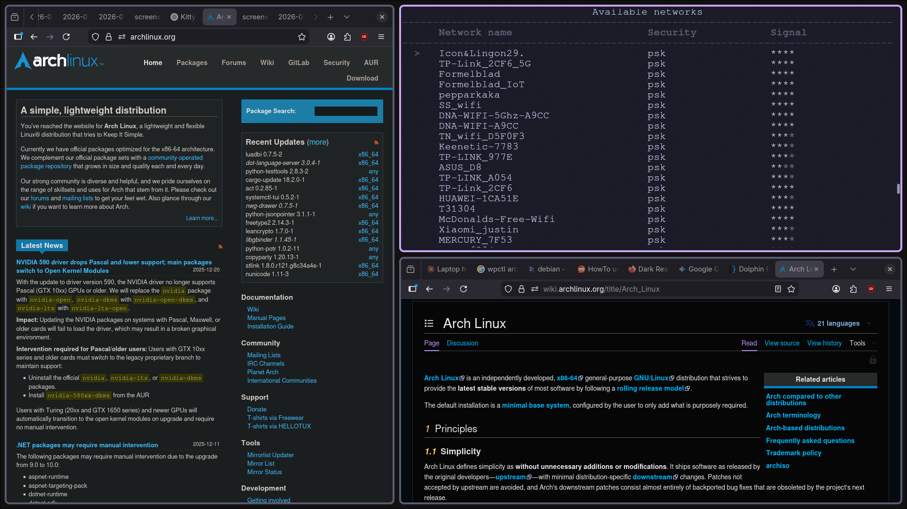

# hyprflow

hyprland minimal setup with automated install script and clean configuration for a ready to use system

this repository provides a minimal and lightweight hyprland configuration for arch linux. it is designed for users who want a clean starting point without unnecessary bloat while still having all essential tools available.

## preview

  
  
  

the setup focuses on simplicity performance and usability. everything included has a purpose and no extra components are added unless they are required for a functional workflow.

## what this setup is built on

this configuration is built on arch linux using the hyprland wayland compositor. it uses common and stable tools that integrate well with wayland and hyprland.

core components include

hyprland as the window manager and compositor  
kitty as the terminal emulator  
rofi as the application launcher  
hyprlock for screen locking  
hypridle for idle and power management  
zsh with oh my zsh for shell experience  
yay for aur package management  

additional tools such as file managers system utilities and media controls are included only where necessary to support a complete but minimal system.

## what makes this minimal

this setup avoids full desktop environments and does not include unnecessary background services or heavy applications. it only installs what is required to run a functional hyprland session.

there is no preconfigured panel or complex theming system. the goal is to give you a clean base that you can extend in your own way.

everything is kept readable and easy to modify so you can understand and control your system.

## installation

clone the repository

git clone https://github.com/yourusername/hyprflow.git

change into the directory

cd hyprflow

make the install script executable

chmod +x install.sh

run the installer

./install.sh

the script will install all required packages set up yay install oh my zsh and place all configuration files into the correct directories in your home folder.

after installation log out and start a hyprland session.

## notes

this setup is intended for arch linux systems  
some hardware specific settings such as monitor configuration may need manual adjustment  
you are expected to have a basic understanding of linux and arch  
